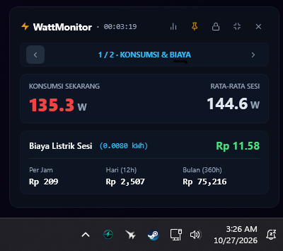
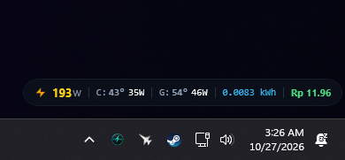

# ⚡ WattMonitor

<p align="center">
  
</p>

Aplikasi desktop Windows ringan berbasis C# WPF Native buat mantau konsumsi daya listrik (Watt), suhu CPU & GPU, serta langsung mengonversinya jadi estimasi **Rupiah tagihan PLN secara real-time**. 

Gak perlu buka software monitoring berat nan ribet kalau cuma mau ngecek PC lagi nyedot berapa ratus watt pas lu tinggal render, compiling, atau maraton game 4K.

---

## 📸 Screenshots

<table>
  <tr>
    <td align="center" width="33%">
      <a href="assets/ss-app-1.png">
        
      </a>
      <br />
      <sub><b>Minimalist HUD</b> (Klik untuk perbesar)</sub>
    </td>
    <td align="center" width="33%">
      <a href="assets/ss-app-2.png">
        
      </a>
      <br />
      <sub><b>Full Dashboard & Menu</b> (Klik untuk perbesar)</sub>
    </td>
    <td align="center" width="33%">
      <a href="assets/ss-app-3.png">
        
      </a>
      <br />
      <sub><b>Laporan & Statistik</b> (Klik untuk perbesar)</sub>
    </td>
  </tr>
</table>

---

## Fitur & Fungsi

Aplikasi ini dibuat simpel untuk kebutuhan praktis:

- **Monitoring Watt & Suhu**: Membaca konsumsi daya dan temperatur CPU serta GPU secara langsung lewat sensor hardware.
- **Estimasi Biaya PLN**: Mengonversi daya (Watt) ke estimasi rupiah per jam, harian, sampai bulanan berdasarkan tarif listrik yang disetel.
- **Input Perangkat Eksternal**: Bisa menambahkan watt statis untuk monitor, kipas, atau komponen lain yang tidak memiliki sensor internal.
- **Mode HUD & Dashboard**: Tersedia mode minimalis (overlay ringkas di layar) dan mode dashboard dengan indikator warna peringatan suhu/daya.
- **Riwayat & Laporan**: Riwayat sesi pemakaian tersimpan otomatis per bulan untuk pengecekan berkala.
- **Pengaturan via GUI**: Konfigurasi tarif, transparansi, font, dan daftar peripheral bisa diatur langsung lewat jendela pengaturan.

---

## 💻 Cara Pakai

1. Download rilisan portable dari tab [Releases](../../releases) atau clone repo ini.
2. Klik kanan **`WattMonitor.exe`** ➔ **Run as administrator** (diperlukan agar sensor hardware terbaca).
3. Klik ikon gear ⚙️ atau klik kanan widget untuk menyesuaikan tarif listrik PLN (default: Rp 1.444,70 / kWh).

---

## 🔨 Build dari Source (Tanpa Tooling Ribet)

Project ini tidak butuh `node_modules` 2GB atau compiler aneh-aneh. Cukup pakai compiler `csc.exe` bawaan Windows:

```cmd
cd system
build.bat
```

Selesai dalam hitungan 2 detik dan menghasilkan file biner siap jalan.

---

## 📜 Lisensi & Aturan Main

Proyek ini dirilis di bawah **WattMonitor Non-Commercial License (WNCL)**.

- ✅ **Bebas & Gratis** dipakai untuk kebutuhan pribadi, riset, hobi, atau belajar.
- ❌ **DILARANG KERAS** memperjualbelikan, menguangkan, atau membundel software ini (baik versi asli maupun hasil modifikasi) ke dalam produk/layanan komersial berbayar dalam bentuk apa pun.

Ketentuan hukum lengkap bisa dibaca di file [LICENSE](LICENSE).
